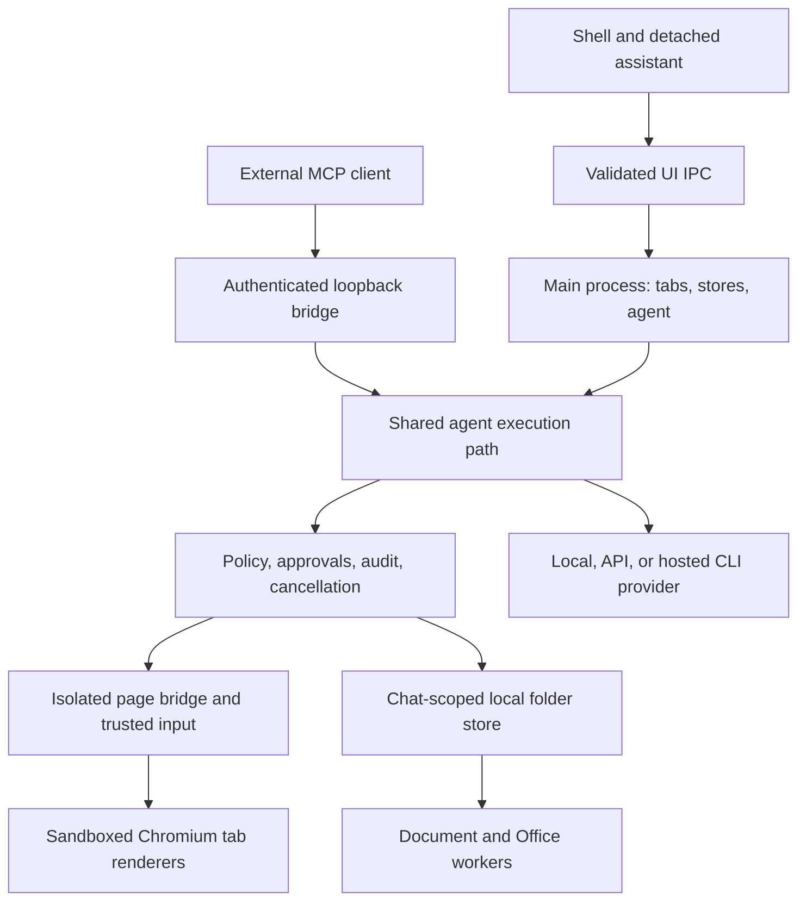
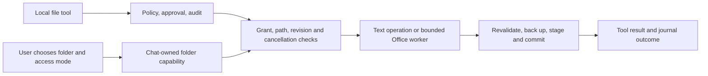

# Architecture

Nabsun embeds Chromium through Electron. The main process owns browser state,
assistant execution, credentials, and integrations. Web pages and the application
UI run in separate renderers.

This document describes the current source, including chat-scoped folder access, Office
editing, and hosted CLI task lifetimes. It distinguishes enforced boundaries
from remaining limitations. See the [README](README.md) for user instructions
and [Security](SECURITY.md) for the threat model.

## Process boundaries

| Component | Responsibility |
| --- | --- |
| Main process | Tabs, stores, agent loop, approvals, providers, and child processes |
| Shell renderer | Toolbar, settings, chat, and integration controls |
| Overlay renderer | Omnibox and command palette |
| Tab renderers | Sandboxed web pages with no Node integration |
| Page bridge | Structured page tools in an isolated JavaScript world |
| MCP bridge | Authenticated loopback access for external agents |
| Parser and Office workers | Bounded document parsing and Office package transformations |
| Native children | Local inference, hosted CLIs, approved integrations, and Windows dictation |

These are application boundaries, not an OS sandbox around every child process.
Approved native integrations and provider CLIs retain capabilities outside
Nabsun's browser tools.

Shell IPC accepts only the expected UI contents, main frame, and local document.
Overlays have a smaller channel allowlist. UI navigation and new windows are
blocked so privileged preloads cannot follow a web navigation.

Each tab uses a `WebContentsView`. Overlays and extension popups use separate
views above the page; toolbar rows reduce the page rectangle. Detach overlays
when closed, and keep clickable controls outside draggable window regions.

Settings and onboarding fill the browser content area. The assistant can be
attached or hosted in a separate window; its text zoom is independent of page
zoom. Queued follow-ups belong to the chat, survive view changes, and are
memory-only. Stop clears that chat's queue as well as cancelling active work.

Internal `nabsun://` pages are registered on the persistent tab session.
Chrome extensions also load into that session and are restored from settings.

## Page tools

`src/page/agent-bridge.ts` produces an accessibility-derived page outline.
Actionable elements receive opaque references containing a per-document token.
Tools reject stale references and changed element identities instead of silently
acting on a different target.

The normal cycle is snapshot, action, then a fresh snapshot. Structured tools
cover reading, clicking, typing, selecting, scrolling, and extraction.
Input tools use serialized CDP mouse and keyboard operations with hit testing,
cancellation and credential checks. Date/time, multi-select and ambiguous macOS
dropdown compatibility fallbacks are disclosed. Frame routing supplies isolated child-document refs and
maps pointer positions through the embedding frame; open shadow roots are included.
`browser_evaluate` permits page JavaScript and is classified as dangerous.

Password and one-time-code fields are excluded from structured credential
entry and value extraction. This is not a security boundary against arbitrary
page JavaScript or a trusted native plugin.

## Agent execution

`Agent.send` persists the user message, builds provider context, streams a
response, and dispatches requested tools until completion, cancellation, or the
step limit. Volatile page context belongs in the user turn; the system prompt
remains stable for caching.

Important invariants:

- Every tool call receives a result, including failures and denials.
- Tool intent and outcome pass through the action journal. Chat transcripts
  are persisted separately, including delegated tool results and stop reasons.
- A run owns its cancellation controller and tab selection.
- The target is captured before approval and checked again before dispatch.
- Mutating handlers recheck cancellation immediately before side effects.
- Only tools offered to the provider may be dispatched.

The in-app assistant follows the user's selected tab. External clients retain
their own tab selection across calls. Stop cancels active runs and releases
pending approvals and questions. Cancellation cannot undo a completed action.

`SessionStore` retains unwritten conversation state after a failed save so a
later successful save can repair history. This best-effort conversation storage
is distinct from the fail-closed action journal. A crash can leave an intent
without an outcome; that means uncertainty, not permission to repeat an action.

Hosted interactive Codex/Claude turns receive a 30-minute default deadline and
a shared 100-action budget for Nabsun tools. Explicit workflow budgets are
capped at five minutes and at most 100 actions. Configured agent-step and
context limits still apply. Ordinary interactive CLI turns do not receive an
implicit cumulative token cap; explicit workflow token budgets and provider
quotas still apply. Unreported CLI-internal work is outside host token accounting.

`interruption.ts` distinguishes user Stop, time limits, and other interruptions.
Explanations are stored with the conversation rather than displayed only
transiently. Disconnecting a folder cancels its owning chat's work; stopping a
turn does not revoke explicit chat-session tool grants.

## Approvals

| Risk | Examples | Default |
| --- | --- | --- |
| `safe` | Read, snapshot, extract | Automatic |
| `write` | Click, type, navigate | Ask |
| `dangerous` | Page JavaScript, destructive MCP tools | Ask |

The sidebar and external MCP bridge use the same `ApprovalManager`.
Approval mode is an explicit persisted choice: Ask, routine actions, or Full
access. Full access needs UI confirmation, is journaled as `full-access`, and
can waive tool prompts for chat and external callers. It cannot bypass a host
policy denial/required prompt, credential guards, or local folder capabilities.
Changing modes through trusted settings clears earlier task/site/session grants.
Configuration imports cannot select Full access or accept the first-use agreement.
Completed approval notes have a separate display preference, off by default;
pending requests and denied decisions remain visible, and auditing is unchanged.
Global per-tool grants are revoked during migration. New grants apply once,
to a task and origin, or to a tool and origin for 24 hours. An explicit,
unchecked chat-session checkbox can also grant a tool/source pair across sites
and subsequent turns in that chat. These grants live only in memory and can be
revoked from the conversation. They end on chat deletion or app shutdown;
Stop keeps them available for the next turn.

Policy is checked before approval and again before dispatch. Without Full
access or an explicit chat-session grant, uploads, arbitrary page JavaScript, Enter/Return
key actions and detected cross-origin submissions force individual approval.
A session grant can cover these tools, but cannot override host policy or
credential guards. Unbound external clients have no chat-session grant scope.

Folder capabilities are a separate requirement. Auto-allowing a file tool cannot
issue a folder grant or upgrade its read-only mode. Browser/site automatic-write
choices do not authorize local file writes. MCP annotations affect classification:
destructive tools are dangerous, read-only tools are safe, and unspecified tools
are write. Trust the server before enabling it.

## Providers and account connections

Providers normalize streaming text, reasoning, tool calls, usage, and stop events.
Adapters support Anthropic, OpenAI, Ollama, the bundled local model, and delegated
Codex/Claude Code agents.

The local adapter starts a bundled `llama-server` lazily, reuses it across turns,
and stops it on shutdown. It serves the bundled Qwen3 1.7B GGUF model over loopback.
Model and engine paths are configurable.

CLI providers delegate their internal loop and expose Nabsun through MCP.
Prompts travel over stdin. Launcher resolution supports native binaries, npm
shims, and Unix symlinks without passing user prompts through a shell.
Codex turns replay bounded conversation context; CLI tool calls still enter
Nabsun's approval path.
Each hosted CLI stream gets an opaque browser capability bound to the real chat
run, instead of selecting a run using a client-supplied id. Delegated browser
actions share approval, auditing and per-action transcript persistence. Completion,
Stop and time limits revoke the capability. Browser action and time limits are
host-enforced; CLI-internal token accounting remains dependent on reported usage.

Delegated calls are serialized through the owning run and filtered against its
offered tools. Local file operations use the host-owned chat scope; an external
caller cannot claim those rights by choosing a client identifier. Credentials
expire with the remaining task deadline rather than a separate five-minute
window. Stream termination revokes access, including pending delegated work.

Account setup is separate from conversation execution:

- `nativeCli.ts` downloads official installer scripts from allowed HTTPS hosts,
  validates redirects and size limits, and supports cancellation.
- `codexLogin.ts` handles Codex app-server login messages.
- `cliAccounts.ts` coordinates installation, sign-in, status, repair, and logout.
- The selected executable is updated only after it starts successfully.
- Cancel/retry and sign-out/sign-in wait for preceding process cleanup.

Existing CLI credentials are reused. Nabsun opens validated provider login URLs;
Claude Code may also open the system browser. Provider credentials stay in the
CLI's store. Signing out affects other uses of that same CLI account.

## Integrations and storage

External clients spawn `dist/bin/nabsun-mcp.js`, which forwards requests to a
loopback HTTP bridge using a per-launch bearer token. The standalone MCP bundle
is unpacked from `app.asar` so it can run as a child process.

Plugins execute CommonJS code in a separate Node permission-restricted process.
Approved source is staged separately, and page helpers reenter the shared agent
gate. Exact source pins require renewed review after edits. Configured MCP
servers remain trusted child processes with an explicit environment allowlist,
configuration/source fingerprints and process-tree cancellation. Their filesystem
and network access are not restricted by a complete OS sandbox. Dynamic package
runners are refused because their downloaded content is not pinned by this path.
Unpacked Chrome extensions have partial Electron API compatibility.

## Local folders and Office documents

Attachments and approved folders have different authority and storage:

| Access path | Authority and storage |
| --- | --- |
| Chat attachment | The user attaches a file; Nabsun keeps an integrity-checked copy addressed by an opaque chat-owned ID |
| Approved local folder | A native picker and confirmation issue an in-memory folder ID and read/read-write mode; operations work on original files |
| Hosted CLI task | Uses the owning chat's capabilities through its temporary task bridge |
| Standalone external MCP client | Cannot claim another chat's folder or attachment scope |

`LocalFolderStore` accepts relative paths within a host-issued grant. It rejects
drive roots, traversal, alternate streams, reserved names, links/junctions,
hard-linked regular files, and protected Nabsun profile/backup/staging paths.
Operations recheck the approved root's identity. Reads and copies are bounded
to 20 MB; text writes to 2 MB. A chat can have up to ten approved folders.
Disconnect, chat deletion, and shutdown revoke access. Disconnect also cancels
active and queued work. Late consent cannot grant access to a stopped/deleted task.

Edits require the current SHA-256 content hash. The store serializes operations,
checks file identity/version, keeps an original backup under `.nabsun-backups`,
and stages replacement bytes before committing them. New destinations must not
already exist. Copy/move preserves bytes; append preserves the existing text.
Trash backs up and invokes the OS Trash/Recycle Bin API for one regular file,
with no permanent-delete fallback. These tools do not execute shell commands
or automate desktop applications.

Office tools transform actual `.docx`/`.xlsx` packages using `runOffice` and
`officeWorker.ts`. The worker has a 25-second deadline, a 256 MB JavaScript heap
limit, and no native addons. ZIP validation bounds package/member sizes and
member counts. XML parsing refuses DTD/entities; archives are not extracted to
disk and external Office relationships are not followed.

- Word creation supports paragraphs and headings. Editing replaces exact body
  text, including text across formatting runs within a paragraph, or appends
  paragraphs. Fields, tracked changes and unsupported structures are refused.
- Excel creation supports named sheets and rows. Editing updates up to 500
  individual cells on a named sheet. Formulas are explicit objects using a
  supported function subset; strings beginning with `=` remain literal text.
  Nabsun does not calculate formulas. Excel recalculates on open unless the
  document's existing manual calculation mode applies.
- Unchanged package parts retain their bytes. Encrypted, macro/ActiveX,
  protected and signed-document edits are refused; old `.doc`/`.xls` formats
  and advanced structural editing are unsupported.

Parsing does not itself authorize a write: the main process still performs
revision, access, backup and cancellation checks before committing returned
bytes. Node path-based commits do not eliminate races against hostile local
programs running as the same OS user. Revocation does not erase content already
shared with a provider or saved in chat.

## Attachments, workflows, voice, and persistence

Chat attachments use opaque, chat-owned ids and integrity-checked copied bytes.
Text, table and PDF parsing runs in a bounded worker; supported images are
normalized for previews and vision models. Datasets, versioned workflows and
batch checkpoints live in separate stores. Replay checks postconditions and
pauses uncertain rows for review instead of automatically repeating a submission.
Browser-only workflow recording refuses tasks that modify local files; it does
not save chat folder capabilities into a reusable workflow.

`AuditSink` records action intent and result before and after the shared action
path. The default local sink uses a daily hash chain and durable checkpoint,
redacts values to fingerprints and blocks further actions after recording failure.
Its viewer/export is available only to trusted application UI.

Dictation is temporarily hidden and is not initialized by the chat renderer.
The retained Windows recognizer implementation and its isolated tests remain
for future reliability work; no cloud transcription is used.

New profiles show a versioned, unchecked usage acknowledgement before onboarding.
Acceptance is saved durably before the guide opens; save failure leaves it
retryable. Existing-profile migration marks the new first-use screen as not
required without claiming acceptance. The workspace prevents Escape/close from
dismissing an unaccepted first-use screen; exiting the application is available.

Settings, chats, history, bookmarks, and plugins live under the application
profile. API keys use Electron `safeStorage`; without secure storage they stay
in memory. Password saving requires secure storage and autofill matches the
complete origin. Optional `soul.md` context is restricted to local providers
by default. See [Security](SECURITY.md) for details.

## Source map

| Path | Contents |
| --- | --- |
| [`src/main/appWindow.ts`](src/main/appWindow.ts), [`tabs.ts`](src/main/tabs.ts) | View layout and tab lifecycle |
| [`src/main/ipc.ts`](src/main/ipc.ts), [`uiSecurity.ts`](src/main/uiSecurity.ts) | UI IPC and sender validation |
| [`src/main/ai/`](src/main/ai/) | Runs, providers, tools, approvals, and chat persistence |
| [`src/main/bridge/`](src/main/bridge/) | External-agent HTTP bridge |
| [`src/main/localFiles.ts`](src/main/localFiles.ts), [`ai/tools/localFiles.ts`](src/main/ai/tools/localFiles.ts) | Folder capabilities, guarded disk operations, and local tool schemas |
| [`src/main/office.ts`](src/main/office.ts), [`officeWorker.ts`](src/main/officeWorker.ts), [`office/`](src/main/office/) | Worker lifecycle and DOCX/XLSX package transformations |
| [`src/main/files.ts`](src/main/files.ts), [`fileParser.ts`](src/main/fileParser.ts) | Chat attachments, previews, and bounded parsing |
| [`src/main/data/`](src/main/data/) | Datasets, workflows, batches, replay, and checkpoints |
| [`src/main/voice.ts`](src/main/voice.ts), [`sitePermissions.ts`](src/main/sitePermissions.ts) | Chat dictation and website device permissions |
| [`src/main/frameBridge.ts`](src/main/frameBridge.ts), [`trustedInput.ts`](src/main/trustedInput.ts) | Child-frame routing and serialized native input |
| [`src/main/integrations/`](src/main/integrations/) | CLI accounts, plugins, MCP, and Chrome extensions |
| [`src/page/`](src/page/), [`src/preload/`](src/preload/) | Page tools and isolated renderer bridges |
| [`src/renderer/`](src/renderer/) | Application UI |
| [`src/shared/`](src/shared/) | Shared types and IPC contracts |
| [`src/test/`](src/test/), `scripts/verify-*` | Automated checks |

## Build and verification

esbuild produces main/preload bundles, renderer assets, an injected page bridge,
and the standalone MCP server. electron-builder packages the app with the model,
native engine, and licenses. Engine manifests record platform, architecture,
file hashes, and library links; packaging also probes native startup.

Use the [contributor guide](CONTRIBUTING.md) for local commands and the
[CI guide](.github/README-CICD.md) for platform checks and release gates.

Published 1.0.1 assets are Windows x64 setup/portable executables, an Apple-silicon
Mac ZIP, and checksums. Windows builds are unsigned; Mac builds are ad-hoc signed
without Developer ID signing or notarization. Platform CI is not a substitute
for trusted publisher signing, installation/upgrade testing, or a security audit.

`main` requires PRs, the existing `verify` check, and resolved review threads,
with no bypass actors. Direct updates, force pushes, and deletion are blocked.
The separate `releases/v-0-x` branch preserves 0.1.13 and is frozen against
updates and deletion. Changes to documentation also follow the PR path.

## Remaining limitations

- Bundled-model task planning has failed diagnostic form attempts; full model
  evaluation, constrained grounding and measured tier/token improvements remain open.
- Host limits cover delegated browser tools; CLI-internal unreported tokens and
  native process capabilities are not strictly constrained by these limits.
- Closed shadow roots and broader nested-frame cases still need coverage.
- Journal concurrency/export edge cases and external-client run lifecycles need
  wider verification; the local hash chain is not a central enterprise audit service.
- Interrupted actions do not have general postcondition-based reconciliation.
- Plugins and MCP servers are trusted native code.
- There is no managed enterprise policy or automatic update channel.
- Profiles/private mode, slim distribution and cross-platform release certification
  remain incomplete. See the [verification record](docs/improvement-status.md).

Prompt injection remains a risk even with approval controls. See the
[security model](SECURITY.md).
